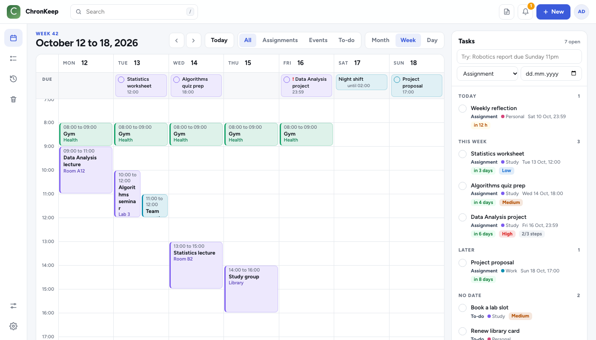
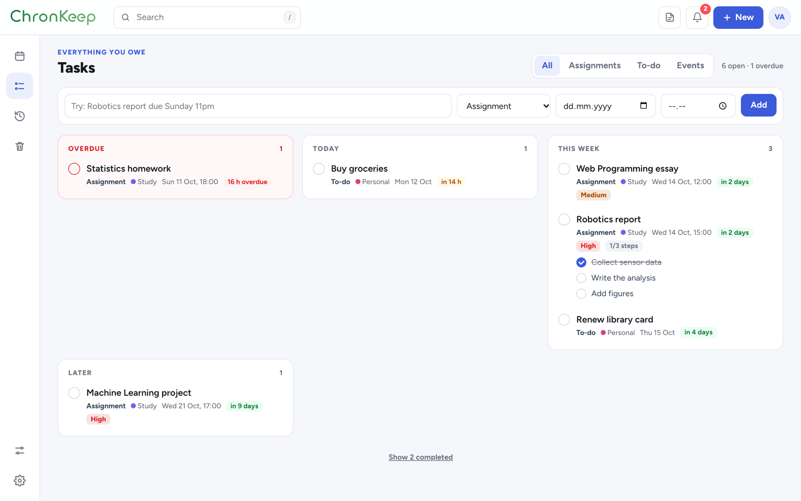
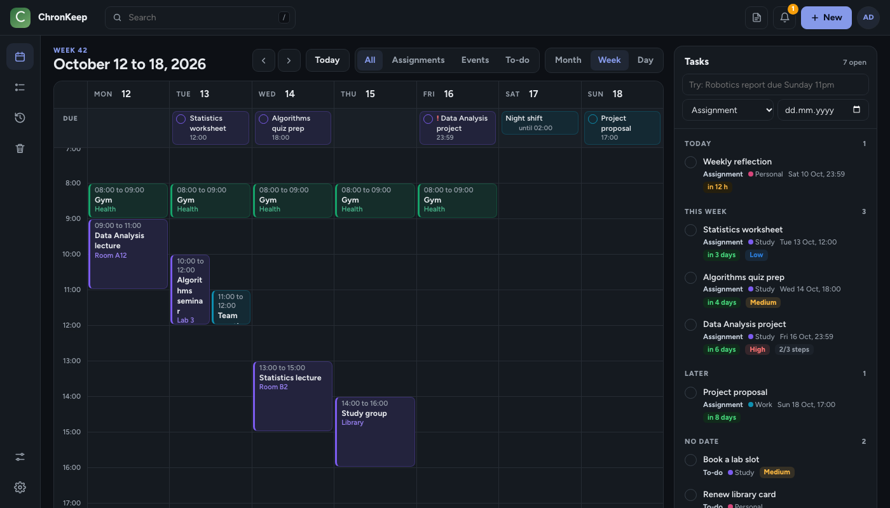

<p align="center"></p>

A calendar and to-do list that keeps reminding you until the assignment is done. On the web and on your phone, always in sync. Built for people who miss deadlines.

## `Tech stack`

<p align="center">
  
  
  
  
  
  
  
  
</p>

The web app and the server are plain JavaScript with one dependency (`pg`). The phone app is in [chronkeep-mobile](https://github.com/victorabuchi/chronkeep-mobile).

## `What it does`

- **One calendar:** day, week and month. Lessons and events are blocks in the hours. Assignments are blocks too, in their own colour, ending at their due time. To-dos and all-day items sit in a slim DUE strip, and same-title deadlines merge into one counted pill.
- **Type it like a sentence:** "Robotics report due Sunday 11pm" becomes an assignment on the right day and time, in the right course, with your usual reminders.
- **Reminders that keep going:** remind once, or keep reminding every few minutes as a deadline gets close, until you tick it off. Reminders are scheduled on the phone, with Snooze and Done on the notification.
- **Tasks:** everything you owe, grouped by when it is due. The To-do page shows each task as a big card with its notes, steps, reminders and files. An Events tab lists what is coming up.
- **Follow your timetable:** paste a calendar link (a university timetable, Moodle) and say whether it holds lessons or deadlines. It refreshes by itself every few hours, and a saved link can be renamed or switched later.
- **The same everywhere:** sign in with email, Google or Apple. Changes, deletions, the bin, settings and files reach every device within about a minute, and offline changes are sent when you are back online.
- **Also:** history with on-time stats, a 30-day bin, steps and priorities, files up to 10 MB, a floating note with checklists, search with add, light and dark, export and delete account.

## `Screenshots`

<p align="center"></p>
<p align="center"> </p>

(Demo data. The screenshots show an earlier version of the design.)

## `Run it`

```sh
npm install
cp .env.example .env     # DATABASE_URL (Postgres, e.g. Supabase), SESSION_SECRET, APP_URL
npm run start:cloud      # http://localhost:3100: landing page, sign in, the web app, the sync API
npm test                 # about 100 tests; the ones that need a database run when TEST_DATABASE_URL is set
```

`node server.js` still runs the original single-person app on port 3000 with no account, if you only want it on your own computer.

## `Deploy`

The Render blueprint is `render.yaml`. [docs/SETUP.md](docs/SETUP.md) walks through Render, Google and Apple sign-in, and password-reset emails.

## `Layout`

```
cloud/             accounts, sessions, Google and Apple sign-in, Postgres, pages
lib/               routes shared by both servers, sync, model, calendar links (ics, calsync), http helpers
public/            the web app: index.html, app.css, js/NNN-name.js joined into app.js, recur.js, quick.js
site/              landing page, sign-in styles, the product film (screenshots made by scripts/shots.js)
scripts/           screenshot tooling, create-user
test/              node:test suites
docs/              API reference and the setup guide
```

The API the web app and the phone app use is described in [docs/API.md](docs/API.md).

## `Contact`

<p align="center">
  <a href="https://www.linkedin.com/in/victor-abuchi-06b086338"></a>
  <a href="mailto:contact@victorabuchi.com"></a>
  <a href="https://victorabuchi.com"></a>
  <a href="https://github.com/victorabuchi"></a>
</p>
