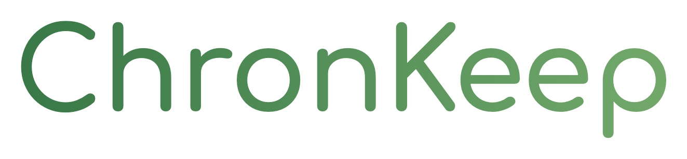

<p align="center"></p>

# ChronKeep

A personal calendar and to-do list that keeps reminding you until the work is done. Built for people who miss deadlines.

- **Search:** find any item on any date from the top bar (press `/`).
- **Type it naturally:** "Robotics report due Sunday 11pm #study" in the sidebar box or the search bar becomes an assignment with the right date, time, course and reminders. Dates like `tomorrow`, `next friday`, `12 oct`, `12.10.`, `in 3 days` and times like `5pm`, `23:59`, `noon` work, and `every monday` makes it repeat.
- **Repeats done properly:** end a repeat on a date, skip a single day, or change only one occurrence (it becomes its own item). Events can run past midnight or over several days.
- **Calendar:** month, week and day views, with assignments, events and to-dos in one place.
- **Tasks page:** everything you owe, grouped as overdue, today, tomorrow, this week and later. Tick items off as you go.
- **History:** completed assignments and to-dos (with "on time" or "2 h late" badges and an Undo) and past events, with a 30-day summary.
- **Bin:** deleted tasks and events wait here for 30 days. Restore them, delete them for good, or undo straight from the toast.
- **Reminders that repeat:** one-off reminders ("1 day before") plus repeating rules ("every 30 min from now, then every 10 min on the due day") that continue until you tick the item. Overdue items keep nagging too.
- **Notifications:** native macOS notifications on your laptop, and push to your phone through [ntfy](https://ntfy.sh).
- **Note:** a floating note with checklists, tables and text styles, always one click away in the top bar.
- **Settings:** profile picture, name, email and phone, a one-click export of your data, and delete account.
- **Customisable:** the Customize page changes the accent colour (type any hex code), theme, courses and colours, day hours and reminder defaults.

No dependencies, no build step. Your data stays on your machine in `data.json`.

## Run

```
node server.js        # or: npm start
```

Open http://localhost:3000. Use `PORT=3001 node server.js` for another port.

## Phone notifications

1. Install the free **ntfy** app.
2. Subscribe to the topic shown in **Customize** (a random name generated on first run; treat it like a password).
3. Press **Send test** in Customize.

Reminders only fire while the server is running.

## Mac notifications

Popups come from a small native `ChronKeep.app` (built automatically with Swift into `~/Library/Application Support/ChronKeep/`, rebuild with `./mac/build-notifier.sh`). They show the ChronKeep icon and have **Snooze 10 min** and **Done** buttons; clicking the notification itself opens the item. Without Swift, a simpler version without buttons is built instead. If macOS blocks notifications for ChronKeep, a banner tells you and Customize has a button that opens **System Settings > Notifications**.

On your phone, Snooze and Done buttons appear when other devices can reach your computer (see Access below). They use signed links that expire after a week.

## Layout

```
server.js        API, scheduler, notifications
mac/             builds the ChronKeep.app that Mac notifications come from
public/          the web app (index.html, app.js, app.css, note.js, note.css)
data.json        your data (created on first run, git-ignored)
```

## Access

ChronKeep only listens on this computer. To open it from your phone or another computer on your Wi-Fi, go to **Customize > Other devices**, set a PIN (6 to 12 digits) and switch on "Allow other devices". Other devices must enter the PIN; five wrong tries lock that address out for a minute. Settings can only be changed from the computer ChronKeep runs on.

## Start at login

**Customize > Start with your Mac** installs a macOS launch agent (`~/Library/LaunchAgents`) that starts ChronKeep when you log in and restarts it if it stops. From the terminal: `node lib/autostart.js install`, `uninstall` or `status`. Logs are in `~/Library/Logs/ChronKeep/server.log`.
